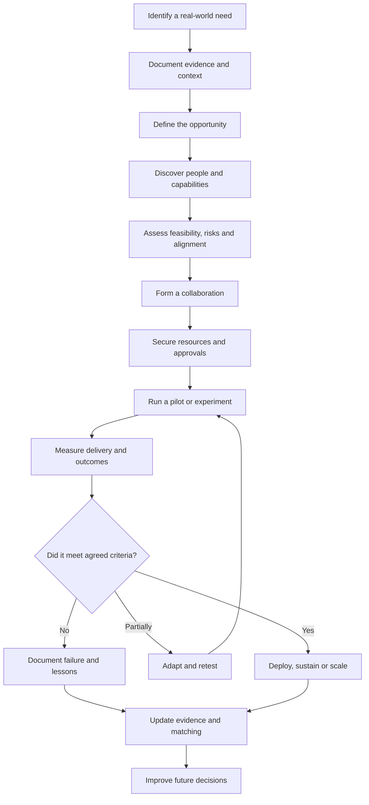
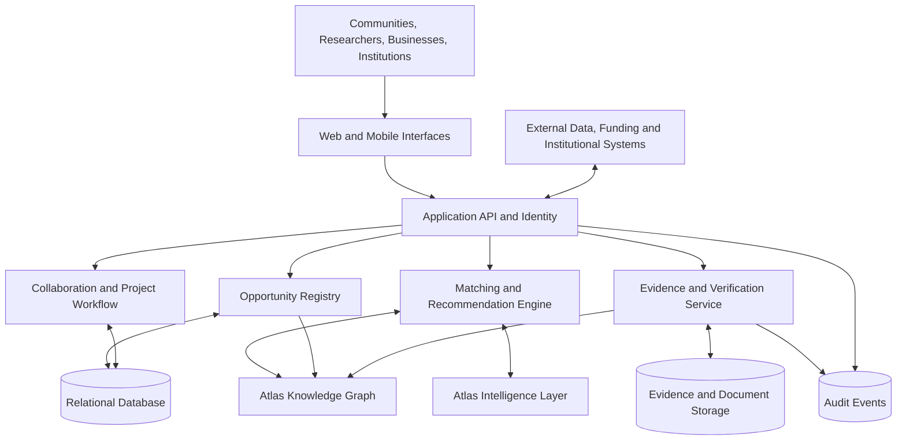

# Atlas Sanctum — Opportunity Exchange Network

### Turning the world's unmet needs into coordinated, measurable action.

[](#project-status)
[](#relationship-to-atlas-sanctum)
[](#mission)
[](#license)

**Opportunity Exchange Network (OEN)** is the opportunity discovery, matching, coordination, and exchange layer of **Atlas Sanctum**.

It connects real-world problems with the people, organizations, technologies, funding, knowledge, and local capabilities required to address them. It helps promising ideas move from discovery to implementation, while maintaining evidence of what was proposed, funded, delivered, and achieved.

The long-term vision is a polycentric network of trusted participants and interoperable local nodes, coordinated through shared protocols for evidence, opportunity, collaboration, verification, and learning.

> The world's problems are not always caused by a lack of resources. Often, the resources, knowledge, institutions, and people capable of solving them cannot find one another, trust one another, or coordinate effectively.

Opportunity Exchange exists to close that gap.

---

## Table of Contents

- [Mission](#mission)
- [The Problem](#the-problem)
- [The Vision](#the-vision)
- [Relationship to Atlas Sanctum](#relationship-to-atlas-sanctum)
- [Core Operating Model](#core-operating-model)
- [What the Network Exchanges](#what-the-network-exchanges)
- [Who the Network Serves](#who-the-network-serves)
- [Core Platform Capabilities](#core-platform-capabilities)
- [Opportunity Lifecycle](#opportunity-lifecycle)
- [Matching Intelligence](#matching-intelligence)
- [Trust and Verification](#trust-and-verification)
- [Reference Architecture](#reference-architecture)
- [Data Model](#data-model)
- [Illustrative Use Case: Rural Water Access](#illustrative-use-case-rural-water-access)
- [Initial Product Wedge](#initial-product-wedge)
- [Minimum Viable Product](#minimum-viable-product)
- [Technology Direction](#technology-direction)
- [Business Model](#business-model)
- [Governance and Ethical Principles](#governance-and-ethical-principles)
- [Success Metrics](#success-metrics)
- [Roadmap](#roadmap)
- [Getting Started](#getting-started)
- [Contributing](#contributing)
- [License](#license)

---

## Mission

Make opportunities discoverable, resources accessible, collaboration trustworthy, and impact measurable.

Opportunity Exchange aims to build infrastructure through which communities, entrepreneurs, researchers, governments, funders, and technology providers can coordinate around problems that matter.

The network should help answer five questions:

1. **What needs to be solved?** Identify real needs and opportunities grounded in evidence.
2. **Who can help?** Discover relevant people, organizations, expertise, technologies, and local capabilities.
3. **What resources are required?** Identify funding, equipment, data, partnerships, infrastructure, and other constraints.
4. **What should happen next?** Coordinate experiments, projects, funding decisions, and implementation.
5. **Did it work?** Verify outputs and outcomes, learn from failure, and improve subsequent decisions.

The objective is not to maximize the number of listings or transactions. It is to increase the number of valuable, trustworthy, successfully executed interventions.

## The Problem

Opportunity is fragmented across disconnected systems.

| Fragment | Consequence |
|---|---|
| Communities understand local needs, but their needs are difficult for institutions to discover. | Problems remain invisible or poorly represented. |
| Researchers produce knowledge, but implementation pathways are often weak. | Research does not reliably translate into action. |
| Funders have capital, but lack consistent evidence about needs, delivery capacity, and outcomes. | Promising initiatives may remain unfunded. |
| Entrepreneurs have ideas, but struggle to find customers, partners, infrastructure, and funding. | Potentially valuable ventures fail to develop. |
| Governments and institutions maintain separate datasets and procurement processes. | Coordination is slow, expensive, and duplicative. |
| Impact claims are reported through disconnected documents and self-reported metrics. | Verification and accountability become difficult. |
| Existing marketplaces focus on individual transactions. | Systemic problems requiring multiple coordinated actors remain unresolved. |

The opportunity is to create a shared coordination layer that connects these fragmented systems without requiring every participant to abandon their existing tools.

## The Vision

Opportunity Exchange is a network for converting unmet needs into coordinated opportunities for action.

A community might identify unreliable water access. A researcher might contribute hydrological evidence. A technology company might provide monitoring equipment. A local entrepreneur might operate a maintenance service. A county government might provide permits and infrastructure data. A funder might finance a pilot. Independent verification might establish whether reliability improved.

Each participant contributes a different capability. The network connects those capabilities around a shared outcome.

The same operating model can extend to:

- Climate adaptation and environmental restoration.
- Rural infrastructure and public services.
- Food systems and agricultural productivity.
- Health access and community wellbeing.
- Renewable energy and decentralized utilities.
- Research commercialization and technology transfer.
- Small-business growth and local economic development.
- Humanitarian response and disaster resilience.
- Regenerative finance and verified impact investment.

These are potential application domains, not claims of existing deployments.

## Relationship to Atlas Sanctum

Opportunity Exchange is one component of the broader Atlas Sanctum ecosystem.

Atlas Sanctum seeks to help institutions turn complexity into trustworthy decisions and decisions into measurable action.

| Atlas component | Responsibility |
|---|---|
| **Atlas Observatory** | Observe places, systems, emerging needs, risks, and changes in reality. |
| **Reality and Knowledge Graph** | Represent entities, relationships, events, evidence, and provenance. |
| **Intelligence Layer** | Evaluate opportunities, identify constraints, analyze scenarios, and support decisions. |
| **Moral Intelligence** | Evaluate dignity, fairness, distributional effects, and potential harm. |
| **Agentic Network** | Coordinate authorized actions among people, organizations, and software agents. |
| **Opportunity Exchange** | Discover opportunities, match participants, coordinate projects, and facilitate resource exchange. |
| **Verification and Impact Layer** | Record delivery evidence, evaluate outcomes, and support accountability. |

The intended feedback loop is:

**Reality → Observation → Knowledge → Reasoning → Values → Agency → Action → Outcomes → Learning**

Opportunity Exchange is the bridge between understanding a problem and mobilizing the capabilities required to address it.

It should integrate with existing tools, institutional systems, datasets, and workflows rather than assume the entire world will move onto one platform.

## Core Operating Model

The network coordinates six fundamental elements.

1. **Problems** — needs, constraints, risks, and unmet demand.
2. **People** — citizens, professionals, researchers, entrepreneurs, and practitioners.
3. **Organizations** — companies, universities, governments, NGOs, cooperatives, and community groups.
4. **Capabilities** — technology, expertise, infrastructure, data, equipment, and operational capacity.
5. **Resources** — grants, investments, procurement budgets, in-kind contributions, and other support.
6. **Outcomes** — delivered services, resolved problems, restored ecosystems, improved resilience, and measurable benefits.

An opportunity emerges when these elements can be connected into a credible path from need to outcome.

The network should support several forms of exchange:

- Problem-to-solver matching.
- Research-to-implementation matching.
- Startup-to-customer matching.
- Project-to-funder matching.
- Community-to-institution coordination.
- Technology-to-deployment matching.
- Capital-to-verified-impact coordination.
- Resource-to-urgent-need allocation.

Not every exchange requires a financial transaction. Some require collaboration, access to expertise, shared infrastructure, knowledge, or institutional commitments.

## What the Network Exchanges

Opportunity Exchange is not simply a job board, crowdfunding site, grant directory, or project marketplace.

It coordinates multiple kinds of value.

| Exchange type | Example |
|---|---|
| Knowledge | A university provides flood-risk analysis to a county. |
| Expertise | An engineer helps a cooperative evaluate a water system. |
| Technology | A provider offers sensors or monitoring software for a pilot. |
| Funding | A funder supports an evidence-backed resilience project. |
| Services | A local business undertakes maintenance or implementation. |
| Infrastructure | An institution provides facilities, equipment, or data access. |
| Partnerships | A county, research team, and operator form a delivery consortium. |
| Verified outcomes | A project demonstrates improvements against an agreed baseline. |

Financial exchanges should be governed by appropriate contracts, eligibility rules, authorization, and applicable law. The platform's initial role is to improve discovery, coordination, evidence, and decision support—not to assume the responsibilities of a bank, regulated investment intermediary, or public procurement authority.

## Who the Network Serves

### Communities

- Express needs in accessible formats.
- Identify relevant support and service providers.
- Participate in defining success.
- Track project commitments and delivery.
- Contribute local knowledge and feedback.

### Entrepreneurs and small businesses

- Discover validated problems and potential customers.
- Find collaborators, technical expertise, and suppliers.
- Identify relevant grants, procurement opportunities, and partnerships.
- Demonstrate delivery capacity and verified results.
- Build a track record of reliable execution.

### Researchers and universities

- Discover field problems and implementation partners.
- Match research outputs to real-world applications.
- Find pilots, datasets, funders, and commercialization pathways.
- Track the use and outcomes of research.

### Funders and investors

- Discover projects aligned with funding mandates.
- Assess evidence, feasibility, delivery capacity, and risks.
- Coordinate milestones and disbursement conditions.
- Monitor implementation and reported outcomes.

### Governments and institutions

- Surface priority problems and project pipelines.
- Identify qualified providers and collaborators.
- Coordinate cross-departmental and cross-sector initiatives.
- Track commitments, milestones, and service outcomes.

### Technology and infrastructure providers

- Identify use cases for their capabilities.
- Find deployment partners and institutional customers.
- Contribute tools and infrastructure to experiments.
- Evaluate performance in real-world settings.

## Core Platform Capabilities

### 1. Opportunity Registry

A structured, searchable record of problems, projects, resources, capabilities, and opportunities.

Every listing should have an owner, a defined purpose, a geographic scope where relevant, and a lifecycle status.

### 2. Need Discovery

Capture needs through structured forms, interviews, field observations, documents, spreadsheets, APIs, and authorized data integrations.

AI-assisted extraction can help convert unstructured information into structured opportunities, with human review where accuracy or consequences require it.

### 3. Intelligent Matching

Recommend relevant people, organizations, resources, and funding opportunities using:

- Domain and capability alignment.
- Geographic relevance.
- Eligibility and constraints.
- Available capacity.
- Budget and resource requirements.
- Evidence quality.
- Delivery track record.
- Timing and urgency.
- Expected outcomes and potential harms.

Matching should explain why a recommendation was made and what information is missing.

### 4. Collaboration Workspaces

Give participating actors a shared place to define objectives, responsibilities, milestones, required resources, and evidence.

### 5. Funding and Resource Coordination

Connect eligible projects to grants, philanthropic support, procurement opportunities, impact-oriented capital, and in-kind resources.

Initially, the platform should discover and coordinate opportunities rather than directly custody funds.

### 6. Project Execution

Track the transition from proposal to experiment, implementation, delivery, and ongoing operation.

### 7. Evidence and Verification

Associate claims with documents, observations, measurements, approvals, and independent assessments.

A submitted claim is not automatically a verified result.

### 8. Opportunity Intelligence

Provide dashboards and analysis that help participants understand:

- Unmet needs by location and category.
- Available capabilities and resource gaps.
- Potential partnerships.
- Project readiness and delivery risks.
- Funding alignment.
- Implementation progress.
- Verified outcomes and unresolved needs.

### 9. Network Learning

Use documented outcomes and feedback to improve opportunity quality, matching, and future decisions.

Learning systems must distinguish between correlation, attribution, and causal evidence.

---

## Opportunity Lifecycle

The network organizes the journey from problem discovery to verified impact.



The lifecycle should preserve the distinction between:

- An identified problem.
- A proposed solution.
- An eligible opportunity.
- A recommended match.
- An agreed partnership.
- A funded project.
- A completed activity.
- A verified outcome.
- A demonstrated causal impact.

These are different states, not interchangeable labels.

## Matching Intelligence

The matching engine should begin with transparent rules and progressively introduce more sophisticated models as sufficient data becomes available.

A candidate matching score could be expressed as:

\[
S(o,a) = \sum_{i=1}^{n} w_i f_i(o,a)
\]

Where:

- \(o\) represents an opportunity.
- \(a\) represents a candidate actor, capability, or resource.
- \(f_i\) represents a normalized matching feature.
- \(w_i\) represents a documented feature weight.

Potential features include domain fit, geographic fit, eligibility, capacity, budget compatibility, delivery evidence, and time constraints.

This score is a prioritization aid, not proof that a candidate is qualified or that a project will succeed.

**Required design principles:**

- Hard eligibility constraints should not be overridden by a high score.
- Recommendations should include explanations and relevant evidence.
- Missing information should reduce confidence rather than silently become a positive signal.
- Participants should be able to correct inaccurate records and challenge recommendations.
- Sensitive attributes should not be used to discriminate or unfairly exclude participants.
- Human decision-makers should retain authority over consequential funding, eligibility, and allocation decisions.

## Trust and Verification

Trust is an operational requirement, not a decorative platform feature.

The network should maintain a traceable record of important claims, commitments, and decisions.

### Evidence categories

| Category | Meaning |
|---|---|
| Submitted | Information supplied by a participant. |
| Documented | A record or supporting artifact is attached. |
| Corroborated | Independent evidence supports the claim. |
| Verified | An authorized verification process has assessed the claim against defined criteria. |
| Outcome measured | A change has been measured against a stated baseline. |
| Impact assessed | Evidence has been evaluated to determine whether the intervention contributed to the change. |

Verification requirements should be proportionate to the stakes. A community suggestion should not require the same documentation as a major institutional funding decision.

### Trust infrastructure

- Organization and participant profiles.
- Role-based access control.
- Provenance for submitted information.
- Evidence versioning and timestamps.
- Conflict-of-interest declarations where relevant.
- Transparent decision and approval records.
- Dispute, correction, and appeal processes.
- Privacy-preserving data sharing.
- Independent verification for high-stakes claims.

The platform should not equate a verified identity with trustworthy conduct, or a successful past project with guaranteed future performance.

## Reference Architecture

The following is a proposed architecture, not a claim that these services have already been implemented.



### Architectural principles

1. **API-first:** expose well-defined interfaces for integrations.
2. **Evidence-first:** connect material claims to sources and provenance.
3. **Modular:** separate opportunity discovery, matching, project coordination, and verification.
4. **Interoperable:** support standard formats and integration with existing institutional systems.
5. **Secure by default:** apply authentication, authorization, encryption, and data minimization.
6. **Human-governed:** make automated recommendations reviewable and consequential decisions accountable.
7. **Incremental:** begin with a small, deployable product and expand when validated demand justifies it.

A modular monolith is a reasonable initial implementation. Distributed services, a dedicated graph database, and autonomous agent orchestration should be introduced only when measurable technical or operational needs justify the additional complexity.

## Data Model

The initial relational model should capture the core objects and their relationships.

| Entity | Purpose |
|---|---|
| `users` | Individual accounts and identity references. |
| `organizations` | Companies, institutions, communities, and other participating entities. |
| `memberships` | User roles and relationships to organizations. |
| `opportunities` | Structured problems, needs, funding calls, and collaboration opportunities. |
| `capabilities` | Skills, technologies, services, and available resources. |
| `opportunity_requirements` | Eligibility, budget, geography, capacity, and other constraints. |
| `matches` | Candidate matches, scores, explanations, and review status. |
| `projects` | Agreed interventions and implementation plans. |
| `project_members` | Project participants and responsibilities. |
| `milestones` | Planned deliverables, deadlines, and completion criteria. |
| `resources` | Funding, equipment, services, data access, and in-kind support. |
| `commitments` | Agreed contributions and obligations. |
| `evidence_records` | Evidence metadata, provenance, verification state, and storage references. |
| `outcomes` | Baselines, measured changes, and outcome definitions. |
| `audit_events` | Traceable records of material actions and decisions. |

### Core relationships

```text
Organization ──< Membership >── User

Opportunity ──< OpportunityRequirement
Opportunity ──< Match >── Organization / Capability

Opportunity ──> Project
Project ──< ProjectMember
Project ──< Milestone
Project ──< Commitment >── Resource

Project ──< EvidenceRecord
Project ──< Outcome
EvidenceRecord ──> Verification decision
```

An opportunity can exist without a project, and a match can exist without an agreement. Funding, project completion, and outcome verification must be represented as distinct states.

Detailed schema constraints, migrations, indexes, and access policies should be defined during implementation.

## Illustrative Use Case: Rural Water Access

Consider a community experiencing unreliable access to safe water.

This example illustrates the intended workflow; it is not a claim of a completed deployment.

**Step 1 — Identify the need**

A community representative records recurring water interruptions, affected households, approximate locations, and the existing water source.

**Step 2 — Establish evidence**

The platform collects available water-point records, maintenance logs, community reports, and relevant technical assessments. Sources and uncertainty are documented.

**Step 3 — Define the opportunity**

The problem is expressed as a concrete challenge: improve the reliability of access to safe water for a defined community, within a specified budget and timeframe.

**Step 4 — Discover capabilities**

The network identifies relevant candidates:

- A local water-system operator.
- A civil or water engineer.
- A university research team.
- A water-quality testing provider.
- A supplier of appropriate equipment.
- A county department or relevant public institution.
- A potential grantmaker or implementation partner.

**Step 5 — Assemble a solution**

Participants propose a practical intervention, define responsibilities, agree on the baseline, and specify the maintenance model.

**Step 6 — Coordinate resources**

The network identifies potential funding and in-kind contributions. Authorized participants make funding and procurement decisions through the appropriate processes.

**Step 7 — Execute a pilot**

The team implements the intervention, records milestones, and collects operational measurements.

**Step 8 — Evaluate results**

The project measures indicators such as service availability, downtime, water-quality compliance, repair time, and cost per household served.

**Step 9 — Learn and improve**

Verified findings inform decisions about maintenance, replication, additional investment, or alternative interventions.

The result is a reusable, evidence-backed record connecting a real need to the actors, resources, actions, and outcomes involved in addressing it.

## Initial Product Wedge

The long-term network could serve many sectors, but the first product should be narrow enough to deliver measurable value.

A suitable initial wedge is **infrastructure and climate resilience opportunity coordination**, aligned with Atlas Sanctum's broader resilience intelligence work.

The first version could help a county, university, NGO, infrastructure operator, or development partner move from an identified local problem to a structured and assessable project opportunity.

### Initial workflow

1. Register a local infrastructure or resilience challenge.
2. Attach available evidence, geographic information, and source records.
3. Define the desired outcome, constraints, and project requirements.
4. Identify relevant expertise, implementation partners, and potential funding sources.
5. Create a structured project proposal.
6. Track approvals, milestones, and contributions.
7. Record delivery evidence and measured results.

The first customer should be an identifiable institution or project operator with a real coordination problem—not an abstract global marketplace audience.

## Minimum Viable Product

The MVP should validate whether organizations will use the platform to discover, assess, and coordinate real opportunities.

### Essential features

- [ ] Secure account registration and authentication.
- [ ] Organization profiles and membership management.
- [ ] Opportunity creation, editing, search, and filtering.
- [ ] Structured categories, geography, and eligibility requirements.
- [ ] Capability and resource profiles.
- [ ] Rule-based candidate matching with explanations.
- [ ] Opportunity-to-project conversion.
- [ ] Project milestones, responsibilities, and status tracking.
- [ ] Evidence uploads and source metadata.
- [ ] Manual verification and approval workflows.
- [ ] Role-based access control.
- [ ] Audit records for material decisions and changes.
- [ ] Basic institutional dashboard and operational reporting.
- [ ] API endpoints for future integrations.

### Explicitly out of scope for the first release

- A global tokenized economy.
- Autonomous disbursement of funds.
- Unsupervised high-stakes AI decisions.
- A universal ontology covering every domain.
- A complex distributed microservice architecture.
- Fully automated impact attribution.
- A public reputation score that claims to measure a participant's overall trustworthiness.

The MVP should prove the value of structured opportunities, relevant matching, coordinated execution, and evidence-based reporting before adding speculative complexity.

## Technology Direction

The implementation should build on Atlas Sanctum's existing web platform and prioritize a working, secure product.

| Layer | Initial direction |
|---|---|
| Frontend | Existing Vite and TypeScript application. |
| UI | Existing React-based interface, if present in the repository. |
| Backend | Supabase/PostgreSQL or an existing compatible backend. |
| Authentication | Managed identity with organization-aware authorization. |
| Evidence storage | Private object storage with controlled access. |
| Search | PostgreSQL full-text search and structured filters initially. |
| Matching | Versioned, explainable rules and scoring. |
| Geospatial | PostGIS or compatible geospatial capabilities where needed. |
| Integrations | Versioned REST APIs and documented data contracts. |
| Observability | Structured logs, error monitoring, and operational metrics. |
| Deployment | Existing platform infrastructure, with environment separation and CI/CD. |

These are proposed defaults, not assertions about the current repository's implementation.

A dedicated knowledge graph, advanced geospatial models, AI agents, event streaming, or specialized matching infrastructure should be added only after the product demonstrates a concrete need for them.

## Business Model

Opportunity Exchange can create value for participants while generating sustainable revenue for the platform.

### Potential revenue streams

**1. Institutional subscriptions**

Paid access to opportunity management, collaboration, analytics, and reporting.

**2. Implementation and integration**

Contracts to configure workflows, connect data sources, and integrate institutional systems.

**3. Research and intelligence services**

Paid analysis of opportunity pipelines, infrastructure risks, resource gaps, and implementation options.

**4. Project coordination services**

Support for multi-party initiatives, structured evidence collection, reporting, and delivery coordination.

**5. Verification and impact reporting**

Evidence management and independent assessment services, with clear separation between platform operations and independent verification.

**6. Opportunity discovery services**

Paid discovery and qualification workflows for institutions seeking implementation partners, relevant programs, or suitable projects.

Commercial terms should be transparent. Payment must not silently purchase favorable rankings, verification status, or preferential treatment in public-interest decisions.

### Value proposition by stakeholder

- **Communities:** greater visibility into needs, commitments, and available support.
- **Implementers:** access to relevant projects, partners, and resources.
- **Funders:** better-structured opportunities and stronger reporting.
- **Institutions:** lower coordination costs and more traceable project execution.
- **Researchers:** clearer pathways from evidence to deployment.
- **Atlas Sanctum:** recurring institutional revenue, a growing evidence base, and a stronger coordination network.

## Governance and Ethical Principles

The network's legitimacy depends on how it handles power, information, access, and accountability.

### Human agency

Participants should understand what the platform recommends and retain appropriate control over consequential decisions.

### Dignity and inclusion

People should not be excluded merely because they lack polished proposals, extensive digital records, formal networks, or institutional visibility. The network should support assisted onboarding and accessible participation.

### Data sovereignty

Communities and institutions should have clear information about data ownership, permitted uses, retention, sharing, and deletion.

### Evidence integrity

The platform should distinguish reported information from independently supported findings. Corrections and disputes should be traceable.

### Fair opportunity allocation

Matching systems should be tested for systematic exclusion, geographic bias, and unfair concentration of resources.

### Accountability

Material funding decisions, commitments, verification actions, and changes in project status should have appropriate records and responsible owners.

### Security and privacy

Apply least-privilege access, secure file handling, appropriate encryption, and data minimization. Sensitive community, commercial, or infrastructure information should not automatically become public.

### Environmental and social responsibility

Success should consider unintended consequences, distribution of benefits, long-term maintenance, and environmental costs—not just activity counts or money mobilized.

## Success Metrics

The network should measure whether it improves the conversion of real needs into beneficial action.

### North-star metric

**Verified opportunities successfully converted into implemented interventions with measurable outcomes.**

### Discovery and matching

- Number of qualified opportunities registered.
- Percentage of opportunities with sufficient evidence and ownership.
- Match relevance and participant acceptance.
- Time from opportunity registration to a viable match.
- Percentage of recommendations reviewed and acted upon.

### Coordination and execution

- Time from discovery to an agreed plan.
- Percentage of projects with clear owners and milestones.
- Time to mobilize required resources.
- Milestone completion rate.
- Project abandonment and failure rates, with documented causes.

### Outcomes and impact

- Percentage of completed projects with measured outcomes.
- Percentage of material outcome claims independently verified.
- Cost per successful intervention.
- Beneficiary-defined improvements.
- Maintenance and durability of results.
- Distribution of benefits across participating communities.

### Network health

- Repeat participation.
- Successful cross-organizational collaborations.
- Geographic and institutional diversity.
- Participant trust and dispute resolution.
- Recurring institutional customers.
- Revenue relative to operating costs.

Activity, engagement, funding volume, and transaction counts are useful operational indicators, but none independently demonstrates real-world impact.

## Roadmap

### Phase 1 — Define and validate

- Interview potential institutional users and implementers.
- Select one specific infrastructure or resilience use case.
- Define opportunity categories and minimum evidence requirements.
- Map the existing Atlas Sanctum codebase.
- Secure an initial design partner and establish baseline metrics.

**Exit criterion:** a documented workflow, a credible user problem, and an agreed pilot scope.

### Phase 2 — Build the MVP

- Implement organization and opportunity records.
- Add search, filtering, and transparent matching.
- Build project coordination and milestone tracking.
- Add evidence storage, verification states, and audit records.
- Deploy a secure pilot environment.

**Exit criterion:** users can register a real opportunity, identify potential collaborators, coordinate a project, and record evidence through a complete workflow.

### Phase 3 — Run an institutional pilot

- Onboard a limited group of organizations.
- Use real opportunities and appropriately authorized data.
- Track coordination time, matching relevance, project progress, and evidence quality.
- Collect participant feedback.
- Document limitations and operational costs.

**Exit criterion:** measured evidence of usefulness, a repeatable workflow, and a credible decision on whether to continue, modify, or stop.

### Phase 4 — Expand the network

- Introduce integrations with relevant institutional systems.
- Improve matching using observed results and validated data.
- Add richer geographic and analytical capabilities.
- Develop repeatable institutional pricing.
- Expand into adjacent opportunity categories only when demand supports it.

**Exit criterion:** repeatable adoption and sustainable delivery economics.

## Getting Started

This repository is intended to become the implementation home for the Opportunity Exchange Network.

Before building new infrastructure, inspect the existing Atlas Sanctum repository and reuse its established conventions, components, authentication, and deployment workflows wherever appropriate.

### Recommended first steps

1. Define the initial opportunity schema and lifecycle states.
2. Identify one institutional user and one real problem to coordinate.
3. Implement opportunity creation, discovery, and transparent matching.
4. Add project milestones and evidence records.
5. Deploy the complete workflow to a pilot environment.
6. Measure whether the system reduces coordination friction and improves project execution.

### Definition of done for the first end-to-end workflow

A pilot user must be able to:

- Create an opportunity with an owner, scope, requirements, and evidence.
- Discover relevant candidate organizations or capabilities.
- Understand why a candidate was recommended.
- Create a project from an accepted opportunity.
- Assign responsibilities and milestones.
- Record supporting evidence and review decisions.
- Report measured outcomes without confusing self-reported claims with verified impact.

A demonstrable, reliable workflow is more valuable than a large collection of disconnected features.

## Contributing

Opportunity Exchange should be developed with the participation of engineers, researchers, community organizations, public institutions, funders, and practitioners.

Contributions should prioritize:

- Real user needs over speculative feature accumulation.
- Clear domain models and documented APIs.
- Security, privacy, accessibility, and interoperability.
- Explainable matching and evidence provenance.
- Reproducible testing and measurable acceptance criteria.
- Documentation of limitations, failures, and lessons learned.

Proposed contribution areas include platform engineering, data modeling, geospatial intelligence, matching systems, research methods, verification workflows, institutional integrations, and governance.

Contribution guidelines, code ownership, security reporting procedures, and licensing should be finalized before opening the project to external contributors.

## License

**To be determined.**

Select and document an explicit license before distributing the code publicly. The software license should not be assumed to grant rights over participant data, third-party datasets, trademarks, or independently owned intellectual property.

---

## The Larger Ambition

Opportunity Exchange is intended to become infrastructure for cooperation: a way for people and institutions to discover where they can contribute, coordinate what they can do together, and establish what their actions actually achieve.

Atlas Sanctum provides the wider intelligence and evidence architecture. Opportunity Exchange connects that intelligence to participation, resources, projects, and implementation.

The long-term ambition is not to centralize every decision in a single institution. It is to enable many capable, locally grounded organizations to cooperate through shared standards and trustworthy evidence.

**Observe reality. Discover opportunity. Connect capability. Coordinate action. Verify outcomes. Learn continuously.**

*Technology, philosophy, and covenant craftsmanship — building systems that help humanity flourish.*

